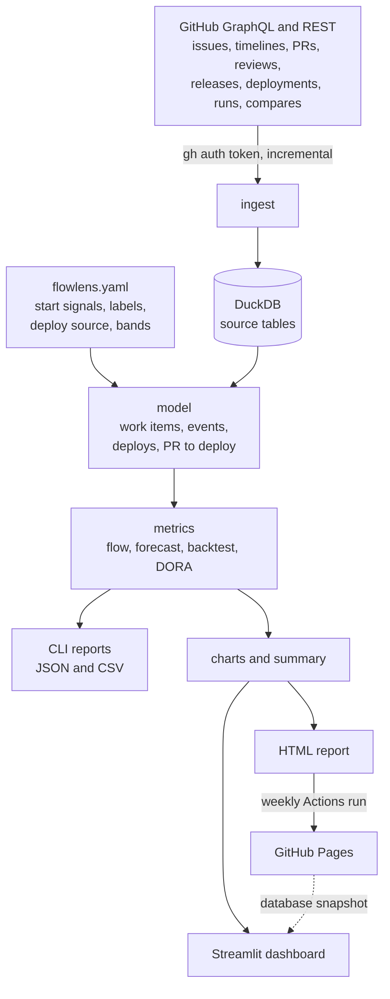

# FlowLens

[](https://github.com/singha105/flowlens/actions/workflows/ci.yml)
[](https://github.com/singha105/flowlens/actions/workflows/weekly-report.yml)

FlowLens turns a GitHub repository's history into delivery numbers you can check: cycle time, throughput, Monte Carlo dates with a backtested confidence, and DORA metrics. It runs locally for free, and every number traces back to the issues and PRs behind it.

**[Live report](https://singha105.github.io/flowlens/)** (rebuilt every Monday from [streamlit/streamlit](https://github.com/streamlit/streamlit)) · [Dashboard screenshots](#the-dashboard) · [Findings memo](docs/INSIGHTS.md) · [Metric definitions](docs/METRICS.md)


## The problem

Every week a team gets asked "how are we doing?" and "when will it ship?". The answers usually come from story points converted to weeks in a spreadsheet, padded by instinct, or from a velocity chart nobody trusts. Neither says how confident it is, and neither is ever checked against what happened. The evidence to do better is already in the repository: every issue, PR, review, release and deployment has a timestamp.

Even an honest statistical forecast needs checking. On the case-study repo, a forecast that promised 85% confidence held 71% of the time once tested against the repo's own past. A gut-feel date never gets that test.

FlowLens is for two people ([PRD](docs/PRD.md)):

- **An engineering manager** of a team of 4 to 10 working in GitHub. They want to see where work stalls and bring numbers to a retro, without a new vendor, an org-wide security review, or a leaderboard of individuals.
- **A product manager** who gets asked for dates. They want a range with a stated confidence ("85% chance these 40 issues are done by Dec 7"), evidence of how far to trust it, and a link to share.

FlowLens reports on the system of work, never on individual developers.

## What it measures

| Metric | The question it answers |
|---|---|
| Cycle time, p50/p85/p95 | Once someone starts, how long does it take? What's a fair delivery promise? |
| Lead time | How long does a request wait from being opened to being delivered? |
| Throughput | How many issues and PRs get delivered each week? |
| WIP and aging WIP | What's in progress now, and what's older than it should be? |
| Cumulative flow | Is work arriving faster than it gets finished? |
| PR flow breakdown | Where does a PR's time go: coding, waiting for review, review, or waiting to merge? |
| Monte Carlo "when" and "how many" | When will these N items be done, or how many by this date, at 50%, 85% and 95%? |
| Forecast backtest | How often would those forecasts have held on this repo's own history? |
| Deployment frequency | How often do changes reach users? |
| Lead time for changes | How long from first commit to release, and how much of that is waiting? |
| Change failure rate | What share of releases is followed by a regression, revert or hotfix? |
| Failed deployment recovery time | How long until a failed release is fixed? |
| Data quality | How much of this history can FlowLens actually measure? |

Every definition, formula, GitHub signal and limitation is in [METRICS.md](docs/METRICS.md).

## Key decisions and trade-offs

- **Count items, don't estimate them.** Forecasts resample weekly delivered-item counts 10,000 times, and every forecast ships with a backtest that says how often it would have held. The trade-off: item size is ignored, and a trend isn't modelled. See [decision 0002](docs/decisions/0002-forecast-from-throughput.md).
- **Percentiles, not averages.** Cycle times are heavily skewed. On streamlit the PR p50 is 1.1 days and the p95 is 38, so a mean describes no real PR.
- **A configurable deploy source, and bands only from cited reports.** Most repos don't record production deploys, so DORA reads releases by default and says so. Performance bands live in `flowlens.yaml` beside the DORA report each comes from. See [decision 0003](docs/decisions/0003-dora-from-releases.md).
- **Local-first and $0.** The user's own `gh` token is read at run time, each repo is one DuckDB file, and sharing is a static page published by GitHub Actions. There is no hosted service and no secrets. See [decision 0004](docs/decisions/0004-local-first-zero-cost.md).
- **A busy demo repo with honest gaps.** streamlit/streamlit was chosen over cli/cli and pydantic/pydantic for volume and a clear release signal, despite its bots and sparse labels. See [decision 0001](docs/decisions/0001-demo-repo.md).
- **Distrust the data until it's checked.** GitHub's GraphQL API silently drops issue timeline events on pages of 50. FlowLens reads 25 to a page, and spot checks of 20 issues and 20 PRs against fresh fetches matched exactly ([Day 2 log](docs/PROGRESS.md)).

## Results on streamlit/streamlit

The window is 26 weeks, Apr 27 to Oct 25, 2026: 884 merged PRs from people (bots excluded), 370 issues delivered, and 14 releases. It is read from two years of history, 9,667 work items. The full memo to the maintainers, with charts, recommendations and limits, is [docs/INSIGHTS.md](docs/INSIGHTS.md).

1. **Release cadence, not coding, sets lead time.** Waiting merged for a release is 60% of lead time for changes: the coding p50 is 1.3 days and the waiting p50 is 8.4. When releases went from monthly to fortnightly in July, the PR lead-time p50 fell from 22.2 days to 9.3.
2. **The first-review wait is the PR bottleneck, and human review is fading.** Waiting for a first human review takes a median of 28 hours, 89% of the summed PR stage medians. The share of merged PRs with a human review fell from 100% in July to 27% in October. Reviewed PRs have a cycle time p85 of 12.3 days, against 1.9 for the rest.
3. **Forecasts are overconfident here: quote the 95%.** The backtest re-made the default forecast (12 weeks of history, 4 weeks ahead) at each of 52 past weeks:

| Unit | 85% forecast held | 95% forecast held | 85% with 26 weeks of history |
|---|---:|---:|---:|
| Issues | 71% | 85% | 79% |
| PRs | 79% | 92% | 83% |

Throughput rose over the year, and resampling the past doesn't see a trend. The report's summary therefore tells readers which forecast to quote.

Against the [PRD's](docs/PRD.md#success-criteria-for-v1) success criteria:

| Criterion | Measured |
|---|---|
| First ingest of ~5,000 items in under 10 minutes | 5,716 items in 7.3 minutes (streamlit, one year) |
| Re-run under 1 minute, under 20% of the GraphQL budget | 8 to 16 seconds; the first ingest used 318 of 5,000 points (6%) |
| A 20-item spot check matches GitHub | 20 issues and 20 PRs matched fresh fetches exactly |
| 85% forecast holds in 75–95% of backtest windows | **Missed for issues:** 71% (PRs 79%). The 95% holds 85%, and the summary says to quote it |
| Dashboard handles 10,000 items in under 3 seconds | Computes all four tabs over 9,667 work items in 1.4 seconds (server side); 0.2 seconds on rerun |
| CI publishes the report to GitHub Pages | Every Monday, plus on demand |
| `git clone` to a report in under 15 minutes | 20 seconds for pallets/markupsafe, clone included |

## Quickstart

You need [uv](https://docs.astral.sh/uv/) and the [GitHub CLI](https://cli.github.com/), logged in with `gh auth login`.

```bash
git clone https://github.com/singha105/flowlens && cd flowlens
uv run flowlens ingest --repo pallets/markupsafe --since 2025-10-01
uv run streamlit run app/dashboard.py
```

`uv run flowlens report --repo pallets/markupsafe` writes the shareable page to `site/index.html`. Each metric also has its own command (`quality`, `flow`, `forecast`, `backtest`, `dora`). [docs/USAGE.md](docs/USAGE.md) covers every command, the settings in `flowlens.yaml`, the GitHub Actions workflows, and hosting the dashboard on Streamlit Community Cloud.

## The dashboard

Pick a repo and a date range, rounded out to whole weeks. Each chart has a one-line caption on how to read it and its data a click away.

| Forecast | DORA |
| --- | --- |
|  |  |
| **PR flow** | **HTML report** |
|  |  |

## How it works



The source tables keep what GitHub returned. The model tables are rebuilt from them on every run, so changing a setting never needs a refetch. Metrics are pure functions over DataFrames, which is what makes them testable against synthetic ground truth.

**Tech stack:** Python 3.12 and uv, DuckDB, pandas and numpy, httpx (GitHub GraphQL and REST), Typer, PyYAML, Plotly, Streamlit, pytest and ruff, GitHub Actions and GitHub Pages.

**Tests:** 417 offline tests, with sockets blocked so none can reach the network:
- flow metrics checked exactly against brute-force loops over seeded synthetic teams, and statistically against known distributions and Little's law;
- forecasts checked against exact and enumerated answers, a no-look-ahead property, and calibration on stationary data;
- DORA checked on hand-built deploy histories with known answers;
- ingest replayed against API responses recorded from markupsafe, streamlit and cli/cli;
- the dashboard run end to end with Streamlit's AppTest.

CI runs ruff and the suite on every push and pull request.

## Roadmap

These are plans, not features.

| Now | Next | Later |
|---|---|---|
| Deployment rework rate, DORA's fifth metric, from patch releases | Jira and Linear import (the model already separates source tables from work items) | A multi-repo portfolio view |
| Revert detection from PR bodies ("Reverts owner/repo#123") | A weekly digest of the three summary bullets to Slack or email | GitLab as a source |
| Review coverage split before and after a date in the PR flow view | A trend-aware forecast option, judged by the same backtest | Forecasts that account for item size |

## Limitations

- **GitHub records only part of the work.** There's no "in progress" state, so starts come from assignments, linked PRs and labels. On streamlit, issue cycle time covers 72% of the issues delivered in the 26-week window, and over two years 46% of finished issues show no start at all.
- **Releases stand in for deploys.** For a library, a release means "on PyPI", not "running in production". The change failure rate depends on labels and on the failure window: 21%, 50% or 79% of streamlit's releases, at 24 hours, 72 hours or 7 days.
- **Forecasts count items and assume the near future looks like the recent past.** The backtest measures how wrong that has been; it doesn't fix it.
- **Durations are calendar days in UTC.** Bots are excluded by default.
- **Items untouched since `--since` are missing.** Old idle work is invisible to WIP and aging.
- **It's a single-user, local tool.** The hosted dashboard shows the last weekly snapshot until it's rebooted.

## Project documents

- [PRD](docs/PRD.md): problem, users, goals, success criteria.
- [METRICS.md](docs/METRICS.md): every definition and limitation.
- [USAGE.md](docs/USAGE.md): commands, settings, workflows.
- [INSIGHTS.md](docs/INSIGHTS.md): the memo to streamlit's maintainers.
- [decisions/](docs/decisions/): decision records.
- [PROGRESS.md](docs/PROGRESS.md): the seven-day build log.
- [CONTRIBUTING.md](CONTRIBUTING.md): how to contribute.

## License

MIT. See [LICENSE](LICENSE).
