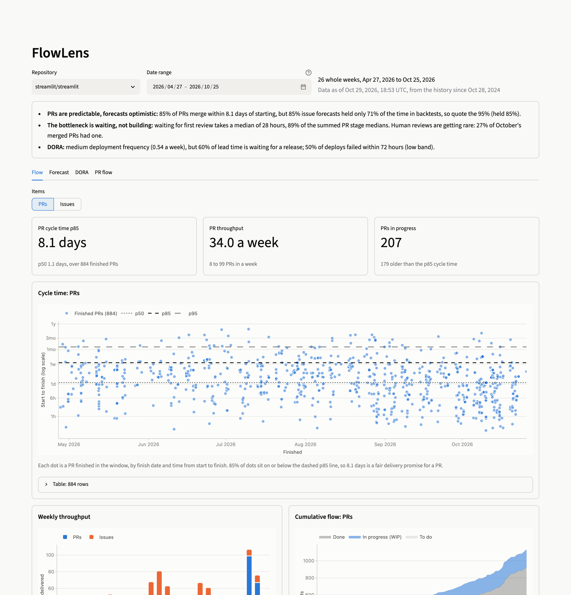
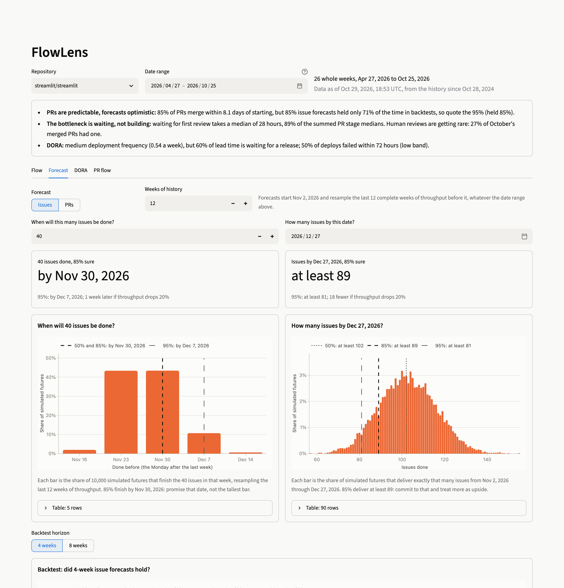
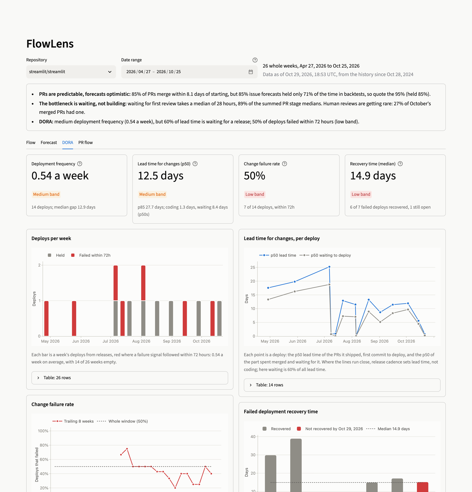
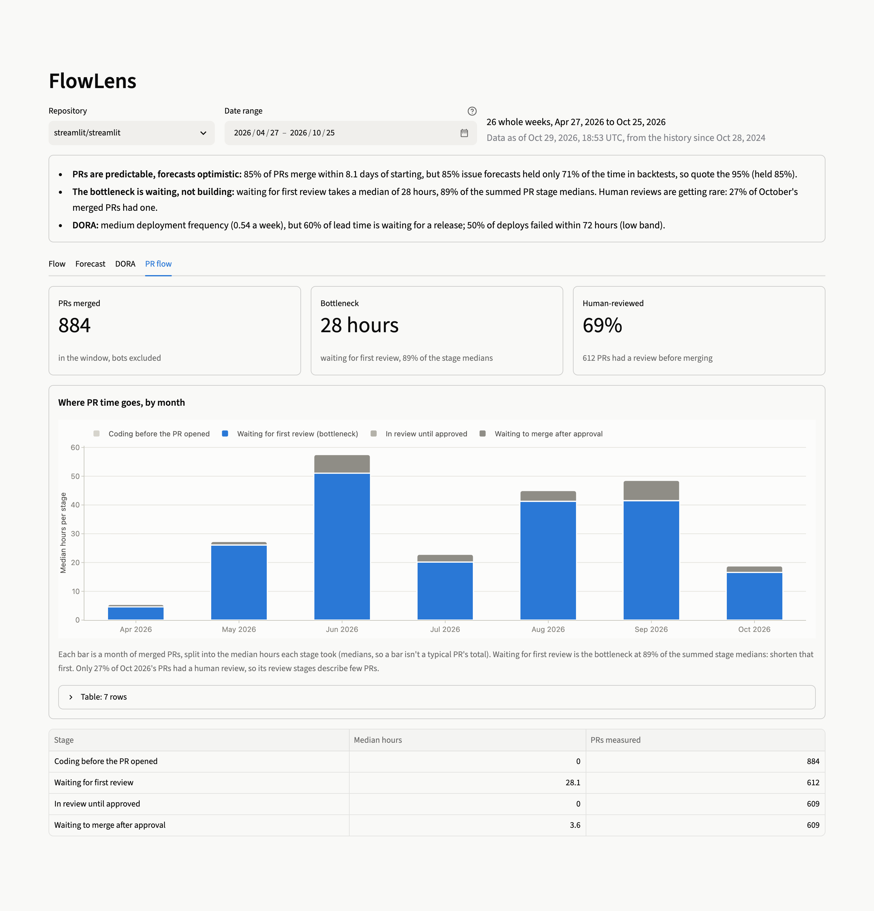
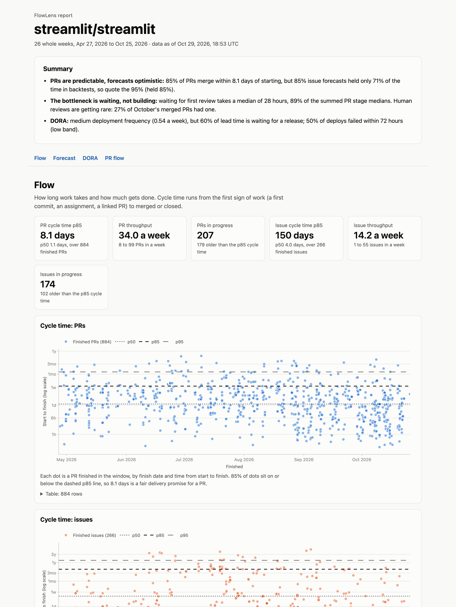

# FlowLens

FlowLens turns a GitHub repository's history into the numbers delivery conversations actually need: cycle time, throughput, and aging work in progress; Monte Carlo forecasts that answer "when will these 30 items be done?" with a date range and a confidence level; and DORA metrics built from real merges, releases, and deployments. It runs locally on your own `gh` credentials, stores everything in a DuckDB file, writes every metric definition down, and costs nothing to run.

**Live report:** [singha105.github.io/flowlens](https://singha105.github.io/flowlens/), rebuilt every Monday from [streamlit/streamlit](https://github.com/streamlit/streamlit) by a GitHub Actions workflow.



> Status: Day 6 of 7. Ingestion, the canonical work-item model, a data-quality report, flow metrics, backtested Monte Carlo forecasts, traceable DORA metrics, a Streamlit dashboard, and a weekly HTML report on GitHub Pages work. See [docs/PRD.md](docs/PRD.md) and [docs/PROGRESS.md](docs/PROGRESS.md).

## Quickstart

Requires [uv](https://docs.astral.sh/uv/) and the [GitHub CLI](https://cli.github.com/) logged in with `gh auth login`.

```bash
git clone https://github.com/singha105/flowlens && cd flowlens
uv run flowlens ingest --repo pallets/markupsafe --since 2025-10-01
uv run flowlens quality --repo pallets/markupsafe
uv run flowlens flow --repo pallets/markupsafe --weeks 26
uv run flowlens forecast --repo pallets/markupsafe --type pr --items 10
uv run flowlens backtest --repo pallets/markupsafe --type pr
uv run flowlens dora --repo pallets/markupsafe --weeks 26
uv run flowlens report --repo pallets/markupsafe
uv run streamlit run app/dashboard.py
```

`ingest` writes `data/pallets__markupsafe.duckdb`: issues with their timelines, PRs with their reviews, releases, GitHub Deployments, and the runs of any Actions workflow you name with `--workflow`. Run it again and only what changed since the last run is fetched; `--full` refetches everything from `--since`. It then rebuilds the model: one `work_items` row per issue or PR with when it started and finished, a `work_item_events` history, a `deploys` stream, and which deploy shipped each merged PR (from the compare API, between each deploy and the one before it).

`quality` reports how much of that history FlowLens can actually measure: how many items have a start signal, how many closed without a reason or without ever starting, how many merged PRs had a human review, and which deployment signals exist. Low coverage is a finding in its own right, so the report spells it out.

`flow` computes the flow metrics over the last `--weeks` whole ISO weeks: lead and cycle time percentiles (p50, p85, p95) per type and label group, weekly throughput, daily WIP, aging WIP, cumulative flow, and where merged PRs spend their time. It prints a summary and writes every series to `data/out/flow_<owner>__<name>.json`. Each metric's definition, formula, GitHub signals, and limitations are in [docs/METRICS.md](docs/METRICS.md).

`forecast` resamples recent weekly throughput 10,000 times to answer "when will these 40 items be done?" (`--items 40`) or "how many will be done by 31 December?" (`--by 2026-12-31`), with 50/85/95% answers and what a 20% throughput drop would do to them. `backtest` checks how well that forecast would have worked: from each of the last 52 weeks, it forecasts 4 and 8 weeks ahead using only the weeks before, then compares the forecast with what was delivered. The method, its assumptions, and when it breaks are in [docs/METRICS.md](docs/METRICS.md#forecasting).

`dora` computes deployment frequency, lead time for changes (split into coding and waiting to deploy), change failure rate, and failed deployment recovery time, each with an elite/high/medium/low band from `flowlens.yaml`. Failures come from merged reverts, hotfix and incident labels, and failed deployment statuses. Every number is traceable: `data/out/dora_<owner>__<name>.json` lists each deploy with the PRs it shipped and the signals against it, and `data/out/dora_failures_<owner>__<name>.csv` lists each failure and why it counted. Definitions, sources for the bands, and limitations are in [docs/METRICS.md](docs/METRICS.md#dora).

The token is read from `gh auth token` each time FlowLens runs and is never written to disk.

## Dashboard and report

`uv run streamlit run app/dashboard.py` opens the dashboard on every repo in `data/`. Pick a repo and a date range (rounded out to whole weeks) and it redraws four tabs, each chart with a one-line caption on how to read it and its data a click away:

- **Flow**: cycle-time scatterplot with p50/p85/p95 lines, weekly throughput, cumulative flow, and aging WIP against the cycle-time percentiles.
- **Forecast**: "when will N items be done?" and "how many by this date?", with the distribution of 10,000 simulated futures and the 50/85/95% answers, and the backtest's calibration chart.
- **DORA**: the four keys with their bands, 26-week trends, and the failed deployments with the signal behind each.
- **PR flow**: where merged PRs spend their time, month by month, with the bottleneck highlighted.

The dashboard only reads: it shows each database as the last `flowlens` command left it. With no data at all it downloads the published streamlit snapshot from the live site.

`uv run flowlens report --repo owner/name` writes the same charts as one page, `site/index.html` (about 5 MB, plotly included, so it opens offline and on a phone), next to `site/data/` with the JSON and CSV it was built from. It opens with three bullets generated from the numbers; the rules behind their wording are in [docs/METRICS.md](docs/METRICS.md#what-the-reports-add).

| Forecast | DORA |
| --- | --- |
|  |  |
| **PR flow** | **HTML report** |
|  |  |

### Automation

- [`.github/workflows/ci.yml`](.github/workflows/ci.yml) runs ruff and the tests on every push and pull request.
- [`.github/workflows/weekly-report.yml`](.github/workflows/weekly-report.yml) runs every Monday at 06:00 UTC and on demand: it ingests streamlit/streamlit with the workflow's built-in `GITHUB_TOKEN` (restoring last week's database from the Actions cache, so only changes are fetched), builds the report, and deploys it to GitHub Pages with the official Pages actions. It also publishes the database, which is what the hosted dashboard downloads.

Both run on the free tier: no secrets to add, no paid services.

### Hosting the dashboard on Streamlit Community Cloud

The repo is ready for [Streamlit Community Cloud](https://share.streamlit.io) (free): [`app/requirements.txt`](app/requirements.txt) installs FlowLens from this repo plus Streamlit, [`.streamlit/config.toml`](.streamlit/config.toml) sets the theme, and no secrets are needed because the app downloads the public snapshot.

1. Sign in at [share.streamlit.io](https://share.streamlit.io) with GitHub and allow access to the repository.
2. **Create app** → **Deploy a public app from GitHub**: repository `singha105/flowlens`, branch `main`, main file path `app/dashboard.py`.
3. Under **Advanced settings**, choose Python 3.12 (or newer). Leave secrets empty.
4. Pick a subdomain (for example `flowlens`) and **Deploy**. The first start downloads the snapshot (about 50 MB) from the live site; the dashboard then shows the data of the last Monday's run. Reboot the app from its menu to pick up a newer week.

## Configuration

`flowlens.yaml` in the working directory says how to read a repository; every key is optional and the shipped file lists the defaults:

- `started_signal`: what counts as work starting on an issue. Default: the earliest of first assignment, the first linked PR being opened, or an `in progress` label.
- `labels`: which labels mark a bug, an incident, or a hotfix.
- `deployment_source`: `releases`, `deployments` (to `deployment_environments`), or `workflow:<name>`.
- `exclude`: items kept but left out of metrics: closed as not planned or duplicate, duplicate/wontfix/invalid labels, and bot authors.
- `dora`: how long after a deploy a failure signal still counts against it (`failure_window_hours`, default 72), and the performance bands with the report each comes from. FlowLens has no built-in bands; the shipped file has approximate ones from the 2024 and 2023 DORA reports.

A `repos: owner/name:` section overrides any of these for one repository. Changing the file takes effect on the next run of any command, without refetching; only a new `deployment_source` needs an `ingest`, to fetch what its deploys shipped.

## Layout

```
flowlens/
├── flowlens.yaml           settings: start signals, labels, deploy source, exclusions
├── docs/
│   ├── PRD.md              product requirements
│   ├── METRICS.md          metric definitions and their limitations
│   ├── PROGRESS.md         daily build log
│   ├── decisions/          decision records (0001: the demo repo)
│   └── img/                README screenshots
├── app/
│   ├── dashboard.py        the Streamlit dashboard
│   └── requirements.txt    dependencies for Streamlit Community Cloud
├── .github/workflows/      CI, and the weekly report on GitHub Pages
├── src/flowlens/
│   ├── cli.py              `flowlens ingest`, `quality`, `flow`, `forecast`, `backtest`, `dora`, `report`
│   ├── config.py           flowlens.yaml loading and validation
│   ├── storage.py          DuckDB schema, upserts, migrations, ingest run log
│   ├── quality.py          data-quality report
│   ├── snapshot.py         one repo's model loaded once, every report for any date range
│   ├── charts.py           the plotly charts, each with its caption and table
│   ├── summary.py          the three-bullet summary and the stat tiles
│   ├── html_report.py      `flowlens report`: the self-contained page and its data
│   ├── ingest/
│   │   ├── client.py       GitHub client: gh auth, retries, rate-limit pacing
│   │   ├── github.py       issues, timelines, PRs, reviews (GraphQL)
│   │   ├── delivery.py     releases, deployments (GraphQL), workflow runs, compares (REST)
│   │   └── runner.py       incremental ingest with per-stream watermarks
│   ├── model/
│   │   ├── work_items.py   canonical work items and the start/finish rules
│   │   ├── deploys.py      deploys from the configured source
│   │   ├── changes.py      which deploy shipped each merged PR
│   │   └── build.py        rebuilds the model tables from the source tables
│   └── metrics/
│       ├── flow.py         flow metrics as pure functions over DataFrames
│       ├── report.py       the `flow` report: JSON and the printed summary
│       ├── forecast.py     Monte Carlo "when" and "how many", and the backtest
│       ├── forecast_report.py  the `forecast` and `backtest` reports
│       ├── dora.py         the four DORA keys and their failure signals
│       └── dora_report.py  the `dora` report: JSON, the failures CSV, and the summary
├── scripts/
│   ├── record_fixtures.py  re-record test fixtures from public repos
│   ├── compare_repos.py    the demo-repo comparison in docs/decisions/0001
│   └── screenshots.py      the README screenshots, through the installed Chrome
└── tests/
    ├── fixtures/           recorded API responses (markupsafe, streamlit, cli)
    ├── fakes.py            offline fakes of the GraphQL and REST APIs
    ├── synthetic.py        seeded synthetic histories with brute-force ground truth
    └── test_*.py
```

Tests never touch the network; `tests/conftest.py` blocks sockets to make sure of it.

## Development

```bash
uv run pytest
uv run ruff check .
uv run ruff format --check .
```

CI runs the same three on every push.

## License

MIT
