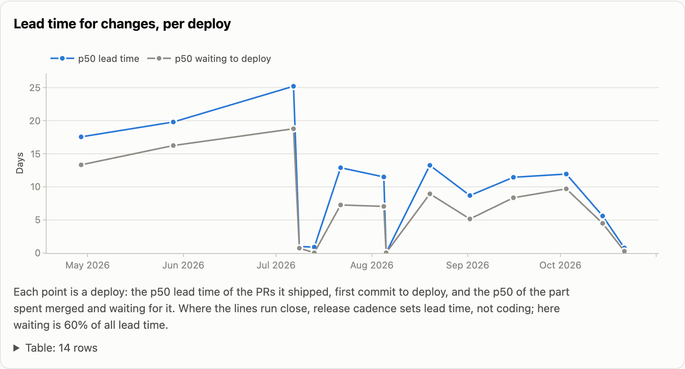
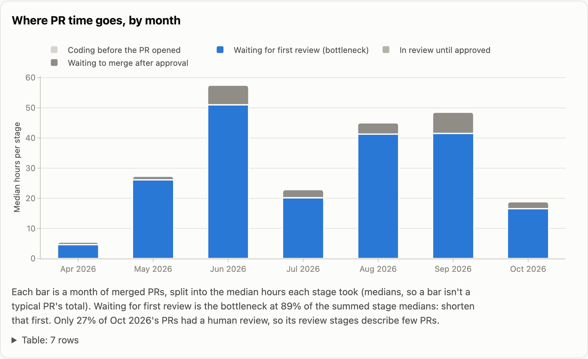
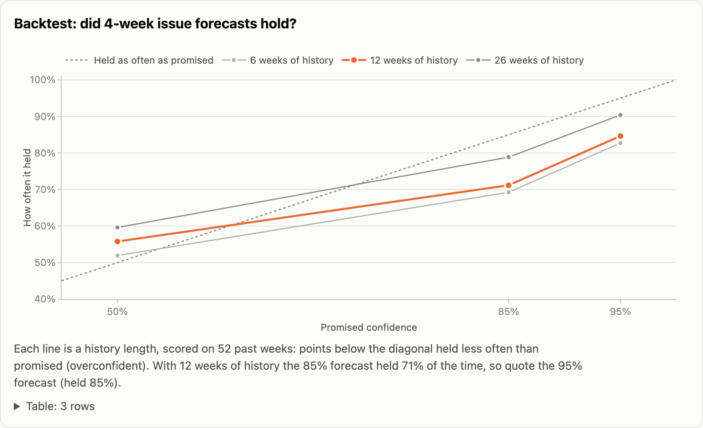

# Delivery at streamlit/streamlit: three findings

To: the streamlit maintainers · From: Arnab Singh · 2026-10-29

This memo reads 26 weeks of your repository's history, Apr 27 to Oct 25, 2026, with [FlowLens](../README.md): 884 merged PRs from people (bots left out), 370 issues delivered, and 14 releases. The data was fetched on Oct 29, 2026, 22:41 UTC, and every number links back to the PRs and issues behind it in the [live report](https://singha105.github.io/flowlens/) and its [data files](https://singha105.github.io/flowlens/data/dora.json). The definitions are in [METRICS.md](METRICS.md).

## 1. Release cadence, not coding, decides how long a change takes to reach users

A merged PR waits longer for a release than it took to write. Across the 864 PRs the 14 releases shipped, lead time from first commit to release has a p50 of 12.5 days and a p85 of 27.7. Coding (first commit to merge) has a p50 of 1.3 days, and waiting merged for a release has a p50 of 8.4 days. Waiting is 60% of all lead time.

The window has a natural experiment. Until July, releases came about monthly: 1.57.0, 1.58.0 and 1.59.0 were 30 and 39 days apart. From 1.59.1 on, a minor release came every two weeks, plus patches, with a median gap of 11.8 days.

| PRs shipped in | PRs | Lead time p50 | p85 | Waiting p50 | Waiting share |
|---|---:|---:|---:|---:|---:|
| 1.57.0 to 1.59.0 (monthly) | 276 | 22.2 days | 35.1 days | 17.0 days | 66% |
| 1.59.1 to 1.66.1 (fortnightly) | 588 | 9.3 days | 18.4 days | 6.9 days | 54% |

Recovery follows the same rule. The one failed release fixed by a patch release, 1.59.0, recovered in 45 hours (1.59.1). The four that waited for the next minor release took 15, 17, 30 and 39 days, and the median across all six recovered releases is 14.9 days.

**Recommendation.** Move to a weekly release, and cut a patch release within two days when a `type:regression` issue lands against the latest one, as 1.59.1 did.

**Expected effect.** A what-if on the same 864 merges, keeping their coding times and releasing every Monday, gives:
- waiting p50 of 4.3 days;
- lead time p50 of 6.1 days and p85 of 13.2 (today 12.5 and 27.7);
- waiting at 37% of lead time.

Patching each failed release the way 1.59.0 was patched would bring recovery from about two weeks down to about two days. These are estimates from your own history: they leave out the cost of cutting more releases.

## 2. The wait for a first review was the bottleneck, and human review is now the exception

For the median merged PR, waiting for the first human review is the only stage that takes real time. From first commit to opening the PR takes 1 minute; opening to first review, 28 hours; first review to approval, 0 minutes; approval to merge, 4 hours. Waiting for review is 89% of the summed stage medians. For reviewed PRs the wait is long-tailed: a p85 of 155 hours, and 53% wait more than a day.

Over the same months, the share of merged PRs with a human review fell. FlowLens doesn't count the bot reviews that started in July.

| Merged in | May | Jun | Jul | Aug | Sep | Oct (to the 25th) |
|---|---:|---:|---:|---:|---:|---:|
| PRs | 97 | 102 | 144 | 150 | 157 | 222 |
| With a human review | 99% | 98% | 100% | 85% | 46% | 27% |
| Cycle time p85 | 7.7 d | 11.2 d | 8.1 d | 15.0 d | 5.4 d | 3.1 d |

PRs with a human review have a cycle time p50 of 2.3 days and a p85 of 12.3. PRs without one have a p50 of 9 hours and a p85 of 1.9 days. The speed-up since August comes with PRs skipping the review queue.

**Recommendation.** Decide which PRs still need a human review, and give those a first-review target of one working day, through a reviewer rotation or a daily triage slot. Start with code that regresses. Five of the 15 regression reports that counted against a release name `st.selectbox` (#14989, #15863, #15985, #16003, #16004).

**Expected effect.** Capping the first-review wait at 24 hours, on the same 612 reviewed PRs, moves their cycle time p50 from 2.3 to 1.1 days and their p85 from 12.3 to 4.2 days. Human review would no longer be the slow path. Whether less review led to more regressions can't be told yet: 2 of the 5 releases since September failed, against 5 of the 9 before, and both samples are too small to separate.

## 3. Forecasts promised 85% and delivered 71%: quote the 95% date

FlowLens forecasts by resampling the last 12 weeks of weekly throughput 10,000 times. The backtest re-made that forecast at each of 52 past weeks (Oct 6, 2025 to Sep 28, 2026), using only the weeks before, and checked it against what was delivered four weeks later.
- **Issues:** the 85% forecast held 71% of the time and the 95% held 85%.
- **PRs:** the 85% forecast held 79% and the 95% held 92%.

The forecasts ran low on average, by 3.8 issues and 11.8 PRs at the p50 over four weeks, because throughput kept rising and resampling the past doesn't see a trend. With 26 weeks of history, the issue forecasts did better: 79% at four weeks, 83% at eight.

**Recommendation.** When you commit to a date or a scope, quote the 95% forecast, and re-run it weekly. Today that means:
- **40 issues:** 85% by Nov 30 and 95% by Dec 7.
- **200 PRs:** 85% by Dec 14 and 95% by Dec 21.

**Expected effect.** Commitments that held 85% of the time for issues and 92% for PRs in the backtest, instead of 71% and 79%. The cost is about one week on these forecasts.

## Limits of this analysis

- **GitHub only records part of the work.** Issue cycle time covers 266 of the 370 issues delivered (72%). Over two years only 41% of issues show a start signal (an assignment, a linked PR, or a label), and 46% of finished issues closed without one.
- **Releases stand in for deploys.** For a library, a release means "on PyPI", not "running in production".
- **Change failure rate depends on the labels and the time window.** `type:regression` issues stand in for incidents, because the repo has no incident or hotfix label. Failures are attributed by time to the latest release, and the rate is 3 of 14 releases with a 24-hour window, 7 of 14 at 72 hours (the 50% quoted), and 11 of 14 at 7 days.
- **The samples are small.** There are 14 releases, split 3 and 11 between the two cadences. Before and after is not cause and effect: coding time halved too (p50 2.2 to 1.1 days), and the review bot arrived in the same months.
- **Bots are excluded.** The analysis leaves out 2,472 bot-authored items over two years. Lead time for changes also leaves out the 679 excluded PRs these 14 releases shipped.
- **The history has gaps and assumptions.** It starts on Oct 28, 2024, so items not touched since then are missing from WIP and aging. Durations are calendar days in UTC, and percentiles of the parts don't add up to the whole.
- **Forecasts count items, not their size.** They assume the next weeks look like the recent ones. The backtest measures how wrong that has been; it doesn't fix it.
- **The what-ifs replay your merges under a different policy.** They don't model the cost of more releases or more reviewer time, or how people would change their behaviour.
